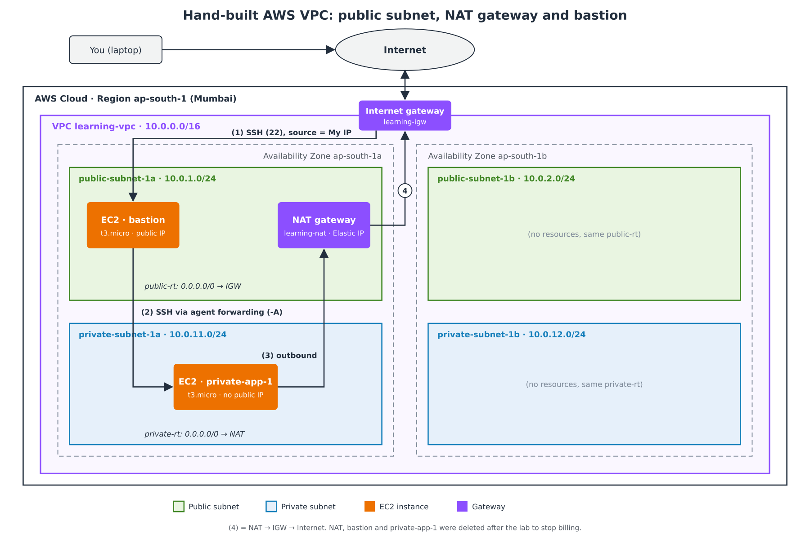

# Hand-built AWS VPC (public + private subnets, NAT, bastion)

Built manually in the AWS Console (ap-south-1) to understand how
VPC networking actually works, with no templates or wizards.

## Architecture

## What I built
- VPC `10.0.0.0/16`
- 2 public subnets and 2 private subnets across 2 AZs
- Internet gateway + public route table (`0.0.0.0/0 → IGW`)
- NAT gateway in a public subnet + private route table (`0.0.0.0/0 → NAT`)
- Bastion host in a public subnet; private instance with no public IP
- Security groups: SSH to the private instance only from the bastion's group

## Subnet plan
| Name | AZ | CIDR |
|---|---|---|
| public-subnet-1a | ap-south-1a | 10.0.1.0/24 |
| public-subnet-1b | ap-south-1b | 10.0.2.0/24 |
| private-subnet-1a | ap-south-1a | 10.0.11.0/24 |
| private-subnet-1b | ap-south-1b | 10.0.12.0/24 |

## How I verified it
- Web server in a public subnet reachable from the browser
- SSH to the private instance through the bastion (agent forwarding)
- `curl https://checkip.amazonaws.com` from the private instance returned
  the NAT gateway's Elastic IP, proving outbound-only internet access

## Screenshots
See [screenshots/](screenshots/).

## Lessons learned
- A subnet is "public" only because its route table points to an IGW
- A NAT gateway must live in a public subnet
- Security group rules can reference other security groups
- NAT gateways bill hourly, so tear them down after the lab

## Cleanup
NAT gateway, Elastic IP and instances were deleted after testing.
